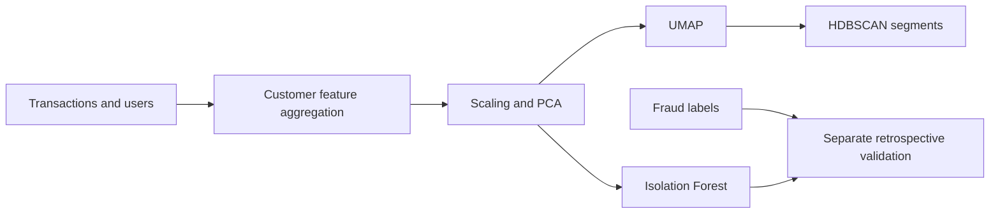

# Financial Behavior Segmentation

Customer-level financial behavior analysis using transaction aggregation, PCA, UMAP, HDBSCAN, K-Means comparisons, and Isolation Forest anomaly scoring.

[](https://github.com/Himanshu-Singhal-compile/financial-behavior-segmentation/actions/workflows/ci.yml)


## Environment

Use Python 3.11 in an isolated environment. The version ranges in `requirements.txt`
describe the intended environment; they are not a fully resolved lockfile.

```sh
python -m venv .venv
# Windows PowerShell:
.venv\Scripts\Activate.ps1
# Linux/macOS: source .venv/bin/activate
python -m pip install -r requirements.txt
python -m jupyter lab
```

Launch Jupyter from the repository root and select a notebook in `notebooks/`.
Data defaults to `data/`; set `PROJECT_DATA_DIR` to override it. Generated artifacts
are ignored by Git. Clear notebook outputs before committing.

## Data preparation

Obtain the [Transactions Fraud dataset](https://www.kaggle.com/datasets/computingvictor/transactions-fraud-datasets) under its published terms. Download and extract it manually into `data/`; no Kaggle credentials belong in this repository.

For the supported preparation script, provide `transactions_data.csv`, `users_data.csv`, and optionally `train_fraud_labels.json`:

```sh
python scripts/prepare_customer_data.py --data-dir data
```

It writes `customer_features.csv` and `id_client_id.csv`; with labels it also writes customer-level `fraud_check.csv`. Preparation aggregates amount statistics, channel/night/weekend ratios, merchant diversity, errors, income, credit score, debt, and spend-to-income ratio. It ignores customer names and card numbers, handles single-transaction standard deviations and zero-income ratios, and keeps labels out of feature construction. Merchant diversity counts MCC codes in this helper; the original engineering notebook counts mapped MCC categories, so outputs can differ.

No source dataset or prepared feature CSV was included in the supplied project folder. Large raw transaction files may require several GB of memory. Data and generated customer identifiers remain local and are ignored by Git.

## Suggested reading and execution order

1. Run the preparation script, then open `notebooks/customer_segmentation.ipynb` for the focused feature → scaling → PCA → UMAP → HDBSCAN → Isolation Forest workflow. Fraud validation additionally requires `train_fraud_labels.json` and the generated ID mapping.
2. Read `notebooks/transaction_feature_engineering.ipynb` for the original raw-data exploration. This notebook additionally requires `cards_data.csv` and `mcc_codes.json`, and writes intermediate CSVs into `data/`.
3. `notebooks/comparative_experiments.ipynb` and `notebooks/early_experiments.ipynb` preserve exploratory variants; they contain manual parameter/cluster interpretation experiments and should be read as research history, rather than a stable pipeline.

## Design and limitations



Cluster IDs can change between data/parameter versions; descriptive names in exploratory notebooks are manual interpretations. UMAP geometry can distort distances, so silhouette scores measured in PCA and UMAP spaces are not directly comparable. Some exploratory cells refit transformations and add cluster annotations to dataframes; the focused notebook is the recommended starting point.

Anomalies are not proof of fraud. Contamination settings determine the fraction flagged, and raising contamination to 50% can increase recall while flagging many normal customers. Historical experiments sometimes treat missing fraud labels as negative; that assumption requires review. No freshly verified fraud-detection benchmark is claimed.

## Validation

```sh
python scripts/validate_notebooks.py
python -m unittest discover -s tests -v
```

CI validates all four notebook files and checks aggregation on a tiny synthetic fixture, including zero income and customer-level fraud counts. Full clustering and historical results were not reproduced without the external data. This is an analysis project, without a deployed fraud decision system.


## Contributing and provenance

See [CONTRIBUTING.md](CONTRIBUTING.md) for the contribution workflow and
[NOTICE.md](NOTICE.md) for source provenance and reuse terms. Dataset licenses
are separate from code rights. No open-source license was present in the supplied
materials, so no blanket license has been added.
